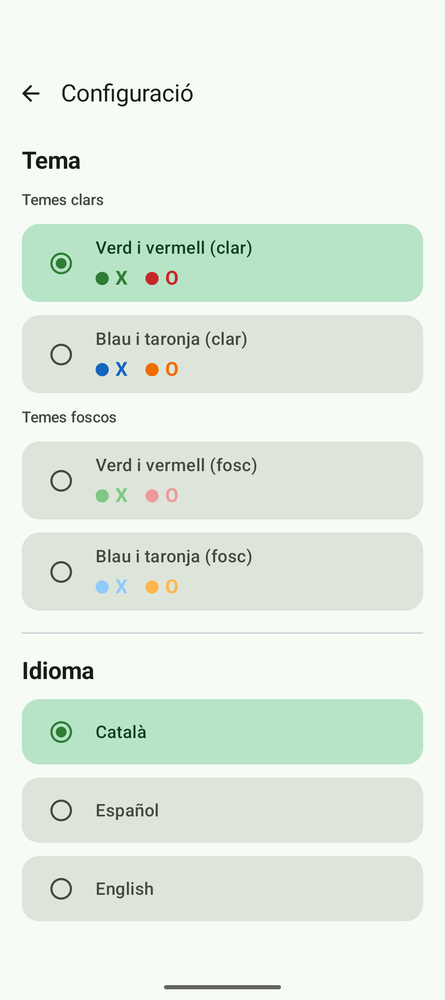
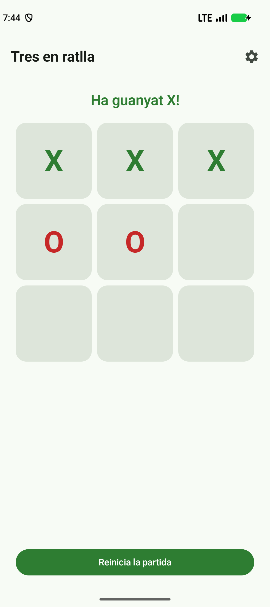

# TresEnRatlla — Tic-Tac-Toe amb MVVM

Aplicació Android de **tres en ratlla** desenvolupada amb **Kotlin**, **Jetpack Compose** i
l'arquitectura **MVVM amb model separat**. La lògica del joc viu al model, el ViewModel exposa
l'estat reactiu i la UI només dibuixa i envia accions.

## 1. Anàlisi i documentació de l'arquitectura MVVM

> Els fitxers de referència `MVVMSimple.kt` i `MVVM-separatModel.kt` són material de classe i no
> formen part d'aquest repositori. L'anàlisi següent es basa en l'estructura que descriu
> `docs/MVVM-Tres en ratlla.md`.

### 1.1. Documentació dels components (MVVMSimple)

- **Model:** conté les dades de l'aplicació i les regles que les fan servir. En un tres en ratlla
  guarda les nou caselles, el torn actual, el guanyador, l'empat i si la partida ha acabat. La
  seva funció principal és validar moviments i decidir l'estat següent sense dependre de Compose.
- **ViewModel:** fa de pont entre el model i la vista. Rep les accions de l'usuari, demana al model
  que les processi i publica l'estat resultant. No dibuixa res i no ha de contenir la lògica pura
  del joc si aquesta ja viu al model.
- **View (UI / Compose):** mostra l'estat i captura les accions. Rep els canvis observant l'estat
  del ViewModel (per exemple amb `collectAsState()`) i li notifica els clics mitjançant funcions
  com `onCellClick(position)`. La vista no modifica el model directament.

### 1.2. Anàlisi comparatiu (MVVMSimple vs MVVM-separatModel)

**Estructura i separació de responsabilitats**

- A `MVVMSimple`, el model i la lògica del joc queden integrats al ViewModel o en una estructura
  molt propera a la UI. El ViewModel acaba assumint tant la gestió de l'estat com les regles del
  joc.
- A `MVVM-separatModel`, el model s'extreu a una classe pròpia (`BoardModel`) amb la seva lògica
  (`makeMove`, `checkWinner`). El ViewModel només coordina: conserva l'estat observable i exposa
  operacions com `onCellClick` o `restartGame`.
- En aquest projecte la lògica de negoci s'executa **al `BoardModel`**, no al ViewModel ni a la
  UI. Això permet provar les regles amb tests JVM sense necessitat d'un dispositiu Android.

**Immutabilitat i gestió de l'estat**

- A `MVVM-separatModel`, el tauler no es muta: es crea una còpia amb `.copy()` i es canvia només
  la part necessària. Per exemple, en marcar una casella:
  ```kotlin
  cell.copy(symbol = currentTurn)
  ```
  i, després de comprovar victòria o empat:
  ```kotlin
  return updatedBoard.copy(currentTurn = currentTurn.opposite())
  ```
- `.copy()` és important per a l'arquitectura reactiva perquè genera una **instància nova** amb un
  estat diferent. Així el flux pot emetre el canvi i Compose pot recompondre la UI. Si es mutés la
  mateixa llista, el canvi seria més difícil de detectar, de desfer i de testejar.
- També evita efectes laterals: qualsevol codi que tingui una referència al tauler anterior
  continua veient un estat coherent.

**Avantatges de la separació**

- La lògica de negoci es pot testejar de manera aïllada i ràpida.
- El ViewModel queda petit i centrat en l'estat de la UI.
- La UI es pot canviar sense tocar les regles del joc.
- Quan l'aplicació creix (puntuació, historial, IA, persistència), el model pot evolucionar sense
  barrejar responsabilitats.

### 1.3. `StateFlow` vs `mutableStateOf`

**`StateFlow` / `MutableStateFlow`**

`StateFlow` és un flux calent de Kotlin Coroutines que sempre té un valor actual. És adequat per
representar l'estat d'una pantalla al ViewModel perquè es pot observar, combinar i testejar sense
dependre de Compose.

```kotlin
private val _boardState = MutableStateFlow(BoardModel.createInitialBoard())
val boardState: StateFlow<BoardModel> = _boardState.asStateFlow()

_boardState.value = _boardState.value.makeMove(position)
```

**`mutableStateOf` / `State<T>`**

`mutableStateOf` és l'estat propi de Compose. Quan el valor canvia, les funcions `@Composable` que
el llegeixen es recomposten. És molt còmode per a estat local de la UI, però si s'utilitza al
ViewModel acobla el ViewModel al runtime de Compose.

```kotlin
var board by mutableStateOf(BoardModel.createInitialBoard())
board = board.makeMove(position)
```

**Diferències i elecció**

| `StateFlow` | `mutableStateOf` |
|---|---|
| Pertany a Kotlin Coroutines | Pertany al runtime de Compose |
| Sempre té un valor (`value`) | És un contenidor observable de Compose |
| Es recull amb `collectAsState()` | Es llegeix directament dins de Compose |
| Molt útil al ViewModel | Molt útil per a estat local de la UI |

En aquest projecte s'ha escollit **`StateFlow` al ViewModel** perquè separa la capa de presentació
de Compose i permet testejar el ViewModel amb JUnit. `mutableStateOf` es reserva per a estats
locals de la interfície que no formen part del model del joc.

## 2. Arquitectura del Tres en Ratlla

### Estructura

```text
app/src/main/java/com/example/tresenratlla/
├── MainActivity.kt                 # Punt d'entrada; aplica l'idioma i mostra TresEnRatllaApp
├── model/
│   ├── CellModel.kt                # Casella immutable
│   ├── PlayerSymbol.kt             # X / O
│   └── BoardModel.kt               # Estat i regles pures del joc
├── settings/
│   ├── AppLanguage.kt              # Català / Español / English
│   └── SettingsRepository.kt       # Persistència amb SharedPreferences
├── viewmodel/
│   └── GameViewModel.kt            # MutableStateFlow + accions de la UI
└── ui/
    ├── TresEnRatllaApp.kt          # Estat del tema/idioma i navegació a configuració
    ├── GameScreen.kt               # Pantalla, estat del joc, reinici i engranatge
    ├── settings/
    │   └── SettingsScreen.kt       # Selectors de tema i idioma
    ├── components/
    │   ├── BoardGrid.kt            # Graella 3x3 amb LazyVerticalGrid
    │   └── CellItemView.kt         # Casella clicable amb el color de X/O
    └── theme/
        ├── AppTheme.kt             # Els quatre temes + LocalPlayerColors
        ├── Color.kt                # Paletes Material 3
        └── Theme.kt                # TresEnRatllaTheme
```

### Temes i idiomes

L'engranatge de la barra superior obre la pantalla de configuració, que ofereix:

- **Quatre temes Material 3**: verd/vermell clar, verd/vermell fosc, blau/taronja clar i
  blau/taronja fosc. El color de la **X** és el verd o el blau, i el de la **O** el vermell o el
  taronja. El tema triat s'aplica immediatament i es desa amb `SharedPreferences`.
- **Tres idiomes**: català (per defecte), español i English. Els textos viuen a
  `res/values/strings.xml` (català), `values-es` i `values-en`.

El canvi d'idioma utilitza les APIs de **locale per aplicació** d'Android:
`AppCompatDelegate.setApplicationLocales(LocaleListCompat.forLanguageTags(...))`. Per això
`MainActivity` hereta d'`AppCompatActivity` i el manifest declara `android:localeConfig` i el servei
`AppLocalesMetadataHolderService`, que desa el locale també a les versions antigues d'Android.
Com que canviar el locale pot recrear l'activitat, `TresEnRatllaApp` recupera el tema i l'idioma
desats perquè la recreació no els perdi.



### Flux d'una jugada

1. L'usuari toca una casella (`CellItemView`).
2. La cel·la crida `onCellClick(position)`, que arriba fins a `GameViewModel`.
3. El ViewModel executa `BoardModel.makeMove(position)`.
4. El model valida el moviment, crea una còpia actualitzada, comprova victòria/empat i retorna el
   tauler nou.
5. El ViewModel assigna el tauler a `_boardState.value`.
6. `GameScreen` recull el canvi amb `collectAsState()` i Compose recompon la graella.
7. Si la partida ha acabat, es mostra el guanyador o l'empat; el botó de reinici tornarà a
   `createInitialBoard()`.

### Captura de l'aplicació



### Com executar-ho

Des de Windows o Android Studio:

```bat
gradlew.bat assembleDebug
gradlew.bat testDebugUnitTest
gradlew.bat connectedDebugAndroidTest
```

Des de WSL, la shell no té Java ni Git propis. Es poden usar les eines de Windows:

```bash
cmd.exe /c "gradlew.bat assembleDebug"
cmd.exe /c "gradlew.bat testDebugUnitTest"
```

> Nota d'entorn: si la ruta del projecte conté accents (per exemple `Programació`), la JVM de
> Windows pot corrompre el classpath dels tests perquè `sun.jnu.encoding` és `Cp1252`. El
> workaround verificat és mapar el projecte a una unitat ASCII i executar els tests des d'allà:
>
> ```bat
> subst T: "C:\ruta\amb\accents\TresEnRatlla"
> cd /d T:\
> gradlew.bat testDebugUnitTest --no-configuration-cache
> subst T: /d
> ```

## 3. Conceptes i mètodes apresos

- **`MutableStateFlow` / `StateFlow`**: estat observable amb un valor actual. El `MutableStateFlow`
  és privat al ViewModel; el `StateFlow` públic és de només lectura.
- **`asStateFlow()`**: converteix el flux mutable en una vista immutable. La UI no pot fer
  `_boardState.value = ...`; ha de passar pels mètodes del ViewModel.
- **`collectAsState()`**: subscriu la UI al `StateFlow` i converteix cada emissió en un `State` de
  Compose. Sense aquest pont, Compose no reaccionaria als canvis del flux.
  ```kotlin
  val board by viewModel.boardState.collectAsState()
  ```
- **`mutableStateOf`**: estat reactiu de Compose. En canviar-lo, es recomponen les funcions que el
  llegeixen. És útil per a estat local, no per al model del joc.
- **`.copy()`**: crea una còpia d'una `data class` canviant només els camps indicats. És la base de
  la immutabilitat del tauler i de la detecció de canvis.
  ```kotlin
  val newCell = cell.copy(symbol = PlayerSymbol.X)
  ```
- **`LazyVerticalGrid` i `GridCells.Fixed(3)`**: graella eficient de Compose. Aquí només compon les
  nou caselles visibles i desactiva el scroll perquè el tauler és fix.
- **`viewModel()`**: obté o crea el `GameViewModel` associat a la pantalla i en conserva la
  instància durant els canvis de configuració.
- **`Scaffold`**: proporciona l'estructura bàsica de Material 3 i gestiona els insets de la
  pantalla.
- **`Surface` amb `onClick`**: afegeix comportament tàctil i estat de polsació a una superfície de
  Material 3.
- **`stringResource()`**: llegeix textos de `res/values/strings.xml` per mantenir la UI
  localitzable. Amb `values-es` i `values-en`, el mateix codi mostra l'idioma actiu.
- **`CompositionLocalProvider` / `staticCompositionLocalOf`**: permeten exposar els colors de X i O
  del tema actiu (`LocalPlayerColors`) a qualsevol composable sense passar-los per paràmetre.
- **`AppCompatDelegate.setApplicationLocales()`**: canvia l'idioma només per a l'aplicació, sense
  tocar la configuració del sistema. `LocaleListCompat.forLanguageTags("ca")` construeix la llista
  de locales.
- **`SharedPreferences`**: emmagatzematge clau-valor síncron. És suficient per a dos ajustos i
  permet llegir el tema i l'idioma abans de la primera composició.
- **`enableEdgeToEdge()`**: permet que l'app dibuixi sota les barres del sistema; el `Scaffold`
  aplica el padding necessari.

## Tests

Els tests unitaris cobreixen la lògica del model i la integració bàsica amb el ViewModel:

- `app/src/test/java/com/example/tresenratlla/model/BoardModelTest.kt`: tauler inicial, torns,
  moviments invàlids, victòria horitzontal/vertical/diagonal, empat i bloqueig després del final.
- `app/src/test/java/com/example/tresenratlla/viewmodel/GameViewModelTest.kt`: estat inicial,
  actualització en clicar i reinici.
- `app/src/test/java/com/example/tresenratlla/ui/theme/AppThemeTest.kt`: hi ha dos temes clars i dos
  de foscos, i cada tema dona colors diferents i visibles a X i O.
- `app/src/test/java/com/example/tresenratlla/settings/AppLanguageTest.kt`: resolució de `ca`/`es`/
  `en` i valor per defecte (català) davant de valors desconeguts.

```bat
gradlew.bat testDebugUnitTest
```

## Autor

Pràctica de Programació Multimèdia per a Apps Mòbils — GSDAM II.
